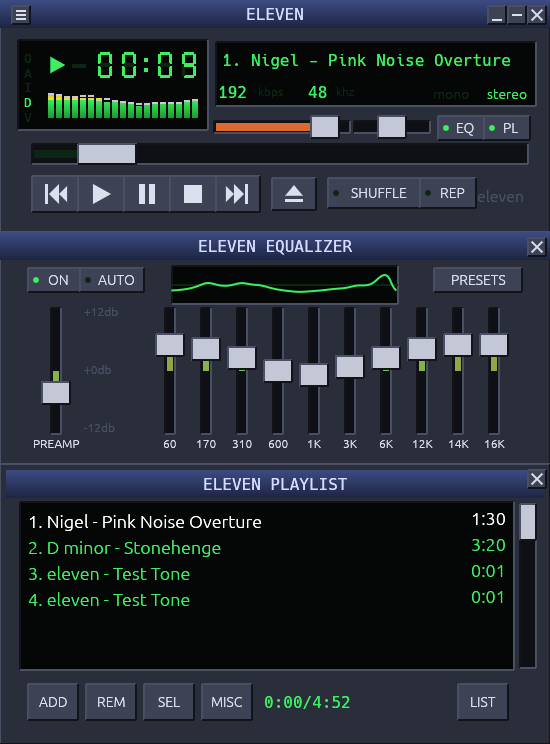

# eleven

An XMMS-style audio player for **Linux and macOS**, written in Rust with [egui](https://github.com/emilk/egui).
It goes to eleven.



## Features

- **Classic layout.** Main window, 10-band equalizer and playlist editor, docked in one 275-pixel-wide window. Each section can be shown or hidden. Also double size, shade mode, always-on-top, and a custom title bar you drag to move the window.
- **Main window.** 7-segment clock (click it to switch between elapsed and remaining), scrolling title, kbps/kHz and mono/stereo indicators, spectrum analyzer or oscilloscope (click it to cycle), seek bar, volume and balance sliders. The volume tooltip reads on a 0–11 scale. The O/A/I/D/V clutterbar opens the options menu and toggles always-on-top, file info, double size and the visualizer mode.
- **Formats.** MP3, FLAC, Ogg Vorbis, WAV, AIFF, and AAC/ALAC in MP4/M4A, decoded by [symphonia](https://github.com/pdeljanov/Symphonia). Audio is resampled to the device rate when needed.
- **Internet radio.** HTTP and Icecast/Shoutcast streams, with in-stream track titles (`StreamTitle`), buffering, and stream URLs inside M3U/PLS files.
- **Equalizer.** 10 bands (60 Hz – 16 kHz, ±12 dB) plus a preamp and a live response graph. Built-in presets, and you can save your own. **AUTO** loads a preset saved for each track (Presets → Save auto-preset).
- **Playlist.**
  - Add files, folders (recursive), or URLs, or drag and drop them in.
  - Multi-select with Ctrl/Cmd and Shift.
  - Sort, reverse, randomize, crop.
  - Jump to file (`J`).
  - Load and save M3U/EXTM3U and PLS.
  - Shuffle and repeat.
  - Total and selected playing time.
  - Tags are read in the background.
- **Skins.** An original built-in look, plus classic Winamp 2 / XMMS `.wsz` skins. If a skin has no equalizer or playlist artwork, those sections fall back to the built-in look. The loader also accepts common quirks: upper-case names, files in sub-folders, and short `viscolor.txt` palettes. It has been checked against five skins from the Winamp Skin Museum.
- **OS integration.** Media keys and "Now Playing" (MPRIS on Linux, Now Playing on macOS), native file dialogs, and keyboard shortcuts that follow XMMS.
- **Persistence.** Settings, EQ presets, the playlist and the current track are saved between runs.

## Building and running

The Rust toolchain is pinned in `rust-toolchain.toml`; `rustup` installs it automatically.

| | Build requirements | Runtime |
|---|---|---|
| **Linux** | `pkg-config`, `libasound2-dev` (Debian/Ubuntu) or `alsa-lib-devel` (Fedora) | X11 or Wayland with `libxkbcommon-x11`, plus an xdg-desktop-portal for file dialogs. PulseAudio and PipeWire work through their ALSA plugins. |
| **macOS** | Xcode command-line tools | macOS 11+ |

```sh
make run                         # release build and run
cargo run -p eleven --release -- ~/Music/album  some.mp3  http://radio.example/stream
make bundle-macos                # macOS: builds dist/eleven.app
```

Command-line arguments (files, folders, playlists, URLs) are added to the playlist and the first one starts playing.

**Linux desktop entry:**

```sh
install -Dm755 target/release/eleven ~/.local/bin/eleven
install -Dm644 packaging/linux/eleven.desktop ~/.local/share/applications/eleven.desktop
install -Dm644 packaging/icon-256.png ~/.local/share/icons/hicolor/256x256/apps/eleven.png
```

## Releases

Pushing a version tag runs the tests, builds the packages and publishes a GitHub release (`.github/workflows/release.yml`):

```sh
# 1. bump `version` in Cargo.toml, then refresh the lockfile so the two agree
cargo update --workspace
git commit -am "Release 0.2.0"
# 2. tag it; the tag must match the version
git tag v0.2.0 && git push origin main v0.2.0
```

| Platform | Files |
|---|---|
| macOS 11+ | universal (Apple Silicon + Intel) `eleven.app` as `.dmg` and `.zip` |
| Linux x86_64 and ARM64 | `.deb` for Debian/Ubuntu, and a `.tar.gz` (built on Ubuntu 22.04, so glibc 2.35+) |

- **Extras:** a `SHA256SUMS.txt` is attached too, and tags with a hyphen (`v0.2.0-beta.1`) become pre-releases.
- **Test builds:** **Run workflow** on the Actions tab tests and builds the packages without ever publishing.
- **Local builds:** `make dist-macos` and `make dist-linux` produce the same kinds of files in `dist/`. The `.deb`'s dependencies are computed from the binary, so a package built on a newer distro requires that distro's glibc.

**macOS security warning.** The app is ad-hoc signed but not notarized, so Gatekeeper blocks the first launch.
- **macOS 15 or later:** open System Settings → Privacy & Security and click **Open Anyway**.
- **macOS 14 and earlier:** right-click the app and choose **Open**.
- **To remove the warning entirely:** notarization needs an Apple Developer ID certificate stored as repository secrets.

## Keyboard shortcuts

`Ctrl` is `Cmd` on macOS.

| Keys | Action |
|---|---|
| `Z` `X` `C` `V` `B` | Previous / Play / Pause / Stop / Next |
| `L` | Add files |
| `Ctrl+L` / `Ctrl+Shift+L` | Open location (URL) / Add folder |
| `J` | Jump to file |
| `←` `→` | Seek ±5 s |
| `↑` `↓` | Volume |
| `S` / `R` | Shuffle / Repeat |
| `Alt+G` / `Alt+E` | Show/hide equalizer / playlist |
| `Ctrl+D` / `Ctrl+W` / `Ctrl+T` | Double size / Shade / Always on top |
| `Ctrl+P` | Preferences (output device, display) |
| `Alt+S` | Skins |
| `Ctrl+A`, `Delete`, `Enter` | Select all, remove selected, play selected |
| `Ctrl+O` / `Ctrl+S` | Load / save playlist |
| `Ctrl+I` | File info |
| `Ctrl+Q` | Quit |

Mouse:

- Double-click a playlist row to play it.
- Double-click a title bar to shade the window.
- Double-click an EQ slider to reset it.
- Right-click the main window for the full menu.

## Configuration and skins

Files live in `~/.config/eleven/` on Linux and `~/Library/Application Support/eleven/` on macOS. Set `ELEVEN_CONFIG_DIR` to override the location.

- `config.toml`: settings, EQ state and user presets. Unknown or missing keys are tolerated. If the file can't be read at all (a typo, say), eleven starts with defaults and keeps the broken file as `config.toml.bad`, so your settings aren't lost.
- `playlist.m3u`: the auto-saved playlist.
- `skins/`: drop `.wsz` files here, then pick one in **Skins…** (in the right-click menu, under **Preferences…**, or `Alt+S`). **Load skin file…** opens any skin directly.

No skin artwork is bundled. To try the skin pipeline without one, run `cargo run -p eleven-skin --example synthetic -- test.wsz`. It writes a placeholder skin with one flat colour per sprite sheet.

## Architecture

A Cargo workspace with four crates:

| Crate | What it does |
|---|---|
| `crates/core` (`eleven-core`) | Pure logic with no I/O, audio or GUI dependencies: the playlist model and shuffle/repeat, M3U/PLS, EQ biquad design, FFT analyzer, ICY metadata demuxer, formatting, config. |
| `crates/audio` (`eleven-audio`) | symphonia decoding, rubato resampling, EQ DSP, the HTTP stream source, the engine thread, and the cpal and silent outputs. |
| `crates/skin` (`eleven-skin`) | `.wsz` archive loading, sprite tables, `pledit.txt`/`viscolor.txt` parsing. |
| `crates/app` (`eleven`) | The `Controller` (player logic), the egui UI, media keys and file dialogs. |

How audio flows:

```
UI thread ──commands──▶ engine thread: decode ─▶ resample ─▶ EQ ─▶ rtrb ring ─▶ output callback
    ▲                                                                    (volume, balance, position,
    └────────────── events (started / finished / error / stream title) ◀── visualizer tap)
```

- Volume, balance and position are lock-free atomics, so they respond instantly.
- Seek and stop flush the ring buffer through an acknowledged epoch counter.
- The UI never touches audio. It calls the `Controller`, which talks to the engine, tag scanner, media keys and file dialogs through traits. Each trait has a fake for tests.
- The built-in look and skins implement one `Look` trait and paint into the same rectangles, so hit-testing and accessibility labels are shared.

## Tests

```sh
make test    # ~200 tests: unit, property (proptest), integration and UI
make lint    # rustfmt --check + clippy -D warnings
make cov     # line coverage via cargo-llvm-cov, gated at 90 %
```

| Area | How it is tested |
|---|---|
| Core logic | Unit tests, plus proptest for playlist invariants, M3U/PLS round-trips, ICY demuxing under arbitrary chunking, and the clock digits. The EQ design is checked against its analytic frequency response. |
| Audio | Committed 1-second fixtures for every format (made by `make fixtures` with ffmpeg) cover decoding and sample-accurate seeking. The DSP output is measured against the design response. The engine runs end to end through a fast silent output. Streams are played from an in-process HTTP/Icecast server, so no network is needed. |
| UI | egui_kittest drives the real UI headlessly: transport, shortcuts, sliders, playlist selection, double-click and menus, dialogs, presets, skins, shade/double size, drag and drop. |

Coverage is about 95 % of lines. Excluded from the gate are `cpal_out.rs` (needs a sound card), `media_keys.rs` (needs a D-Bus or macOS session) and `main.rs`.

CI (`.github/workflows/ci.yml`) runs on Ubuntu and macOS. It runs fmt, clippy and tests on both, coverage on Linux, and builds the `.app` bundle on macOS.

## Known limitations

- **Untested on real setups.** Audible output on real hardware and behaviour on a real macOS desktop have not been verified. CI proves it builds and the tests pass on macOS; a manual run is still needed.
- **Window management.** Wayland ignores always-on-top and doesn't let apps position windows. Minimizing the borderless window may not work on every desktop; turn on **Preferences → Use the system window frame** if your window manager misbehaves.
- **Not implemented:**
  - Gapless playback and crossfade.
  - Plugins.
  - CD audio.
  - Tag editing.
  - Shaped skin windows (`region.txt`).
  - Old Shoutcast v1 servers that answer with `ICY 200 OK` instead of HTTP.
  - Windows (probably close, but untested).
- **Fixed EQ curve.** The equalizer uses fixed-Q peaking filters, so neighbouring bands overlap, which is noticeable at 12/14/16 kHz.
